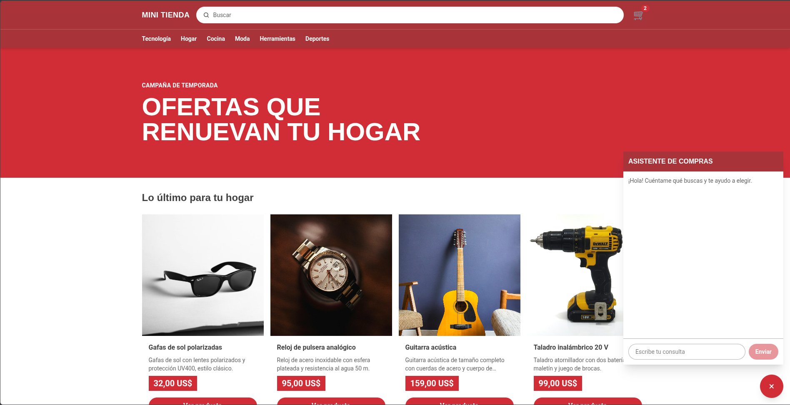

# Mini tienda

Mini tienda is a Next.js storefront prototype for browsing a product catalog, viewing product details, and using a browser-local cart. Its AI shopping assistant searches the catalog, recommends products, opens product details, and can add products to the cart.

Products and their embeddings are stored in PostgreSQL with pgvector. Product images are uploaded to the local S3-compatible RustFS service. The `/admin/products` page creates and deletes catalog items; it is currently unauthenticated and intended for local/demo use only. Checkout is not implemented.

The customer-facing catalog is served from `/`, with product pages under `/product/<id>` and the cart at `/cart`.

## Homepage



## Local development

Follow the [local setup guide](docs/getting-started.md) to install dependencies, use Docker Compose for PostgreSQL and RustFS, apply the checked-in migrations, configure environment variables, and run the verification commands. From the repository root, the supported local services path is:

```bash
docker compose --env-file .env.local up -d
```

The checked-in sample catalog dump is at [`database/sample.sql`](database/sample.sql); the setup guide documents its restore workflow and its RustFS image limitations.

```bash
pnpm install
pnpm dev
```

Open [http://localhost:3000](http://localhost:3000) after completing the setup guide.

## Project links

- [Getting started](docs/getting-started.md)
- [Next.js documentation](https://nextjs.org/docs)
